# Hệ thống điều khiển xe rover qua mạng Wi-Fi dùng PX4

## Mục tiêu dự án
Xây dựng ứng dụng điều khiển và giám sát xe rover qua mạng Wi-Fi.
Xe chạy firmware PX4 và giao tiếp với ứng dụng bằng giao thức MAVLink.
Trong giai đoạn phát triển, xe được mô phỏng bằng PX4 SITL + Gazebo (xe mẫu `gz_r1_rover`).

## Thành viên thực hiện
- Vũ Duy Dương
- Trương Nhật Hoàng
- Đinh Trần Thảo Phương

## Giảng viên hướng dẫn
TS. Đào Duy Tuấn

## Phương pháp
Agile (Scrum kết hợp các thực hành XP):
- Làm theo từng sprint ngắn. Mỗi sprint hoàn thành một hoặc vài user story.
- Phần nào test tự động được thì viết test trước rồi mới viết code.
- Nhóm tự chạy kiểm thử chấp nhận với xe mô phỏng.
- Story mới chỉ được thêm vào product backlog sau sprint review và retrospective.

## Trạng thái hiện tại
Sprint 3 – US-03b: Lái xe tiến, lùi, quay bằng phím; sắp lại code theo 4 tầng.

## Tổng quan hệ thống

Chú thích ký hiệu và luồng chạy: [docs/diagrams/system-overview/system-overview.txt](docs/diagrams/system-overview/system-overview.txt)

## Quy trình làm việc theo Agile

Một vòng lặp gồm các bước sau. Hết một vòng thì quay lại bước 1 cho sprint tiếp theo.

    [1] Product backlog
          |
    [2] Sprint planning
          |
    [3] Daily Scrum  <-- thực hiện các task
          |
    [4] Kiểm thử chấp nhận
          |
    [5] Sprint review
          |
    [6] Sprint retrospective
          |
          +--> quay lại [1]

### 1. Product backlog – chọn việc cần làm
- Khách hàng (Product Owner) đưa yêu cầu. Mỗi yêu cầu được viết thành user story theo mẫu:
  "Là <vai trò>, tôi có thể <hành động> để <mục đích>."
- Các story được sắp xếp theo độ ưu tiên.
- File: `docs/agile/product-backlog.txt`

### 2. Sprint planning – lên kế hoạch cho sprint
- Chọn story ưu tiên cao nhất cho sprint.
- Viết tiêu chí chấp nhận: khách hàng kiểm tra bằng cách nào, kết quả thế nào thì đạt.
- Chia story thành các task nhỏ. Với mỗi task, ghi rõ phần nào test tự động, phần nào kiểm bằng tay.
- Đặt mục tiêu sprint, gói trong một câu.
- File: `docs/agile/user-stories/US-xx.txt`, `docs/agile/sprints/sprint-xx.txt`

### 3. Thực hiện sprint – làm từng task
Với mỗi task, làm theo thứ tự:
1. Chuyển trạng thái task sang `DOING`.
2. Viết test trước (nếu test tự động được). Chạy `pytest`: test mới phải **fail**.
3. Viết code. Chạy lại `pytest`: toàn bộ test phải **pass**.
4. Commit theo dạng `US-xx/Tx: <nội dung>`.
5. Kiểm tra lại Definition of Done, rồi chuyển task sang `DONE`.
6. Nếu gặp lỗi chưa sửa được, ghi vào `docs/agile/bug-log.txt`.

Trong suốt sprint, nhóm họp ngắn hằng ngày (daily stand-up). Mỗi người trả lời ba câu:
đã làm gì, sẽ làm gì, đang vướng gì.

### 4. Kiểm thử chấp nhận
- Khi tất cả task đã `DONE`, nhóm tự chạy các tiêu chí chấp nhận (AC) với xe mô phỏng theo `docs/acceptance/US-xx-acceptance.txt`.
- Ghi kết quả Đạt/Không đạt cho từng AC vào `docs/agile/sprints/sprint-xx.txt`.

### 5. Sprint review – đánh giá sản phẩm
- Trình diễn phần mềm đã làm được trong sprint.
- Kết luận story có đạt hay không, và ghi lại phản hồi của khách hàng.
- Story đạt thì chuyển trạng thái sang `XONG` trong product backlog.

### 6. Sprint retrospective – đánh giá cách làm
- Điều gì làm tốt, điều gì cần cải thiện, hành động cụ thể cho sprint sau.
- Cùng thống nhất story tiếp theo và thêm vào product backlog.
- File: `docs/agile/sprints/sprint-xx.txt` (phần Retrospective)

### Trạng thái dùng trong tài liệu
| Đối tượng | Các trạng thái |
|---|---|
| Story | `MOI` → `SAN_SANG` → `DANG_LAM` → `XONG` |
| Task  | `TODO` → `DOING` → `DONE` |
| Lỗi   | `MO` → `DANG_SUA` → `DA_SUA` |

## Tài liệu dự án
Thư mục `docs/` chia theo người đọc:
- `docs/agile/`: tài liệu nội bộ của nhóm phát triển (quy trình Scrum).
- `docs/acceptance/`: tài liệu cho khách hàng / Product Owner tự chạy kiểm thử chấp nhận.
- `docs/diagrams/`: các lưu đồ, sơ đồ dùng trong dự án; mỗi sơ đồ một thư mục gồm nguồn `.mmd`, ảnh `.svg`, chú thích `.txt`.

| File | Nội dung |
|---|---|
| `docs/agile/product-backlog.txt` | Danh sách user story theo thứ tự ưu tiên và trạng thái |
| `docs/agile/definition-of-done.txt` | Điều kiện để task và story được tính là xong |
| `docs/agile/bug-log.txt` | Nhật ký lỗi |
| `docs/agile/user-stories/US-xx.txt` | Chi tiết từng story: tiêu chí chấp nhận, task, yêu cầu test |
| `docs/agile/sprints/sprint-xx.txt` | Mục tiêu sprint, sprint backlog, kết quả review và retrospective |
| `docs/acceptance/US-xx-acceptance.txt` | Thủ tục kiểm thử chấp nhận từng story: lệnh chạy, kết quả mong đợi cho từng AC |
| `docs/diagrams/system-overview/` | Sơ đồ tổng quan hệ thống và chú thích |

## Môi trường
- Ubuntu, VS Code
- PX4-Autopilot (PX4 SITL + Gazebo)
- Python 3

## Cài đặt (lần đầu sau khi clone)

    git clone https://github.com/wenxizhabg/rover-control-by-PX4
    cd rover-control-by-PX4
    python3 -m venv venv
    source venv/bin/activate
    pip install -r requirements.txt

## Chạy test

    pytest          # tóm tắt: mỗi dấu . là một test pass, F là fail
    pytest -v       # hiện tên từng test và PASSED/FAILED

Kết quả đạt: dòng cuối báo toàn bộ `passed`, không có `failed`.

## Bật và tắt mô phỏng

### Bật
Mở một terminal riêng cho mô phỏng (giữ nguyên terminal này trong suốt quá trình làm việc):

    cd ~/PX4-Autopilot
    make px4_sitl gz_r1_rover

- Lần đầu chạy sẽ biên dịch PX4, mất vài phút. Những lần sau chạy nhanh hơn.
- Bật xong khi: cửa sổ Gazebo hiện xe `r1_rover` và terminal hiện dấu nhắc `pxh>`.

### Kiểm tra PX4 đang gửi MAVLink cho ứng dụng
Tại dấu nhắc `pxh>`, gõ:

    mavlink status

Tìm instance có `mode: Onboard` và dòng:

    transport protocol: UDP (14580, remote port: 14540)

Nghĩa là PX4 gửi MAVLink  tới cổng 14540 trên localhost. Đây là cổng ứng dụng của nhóm nghe.
Instance mà có `remote port: 14550` dành cho QGroundControl.

### Tắt
Tại dấu nhắc `pxh>`, gõ `shutdown`, hoặc nhấn `Ctrl+C` trong terminal mô phỏng.

Nếu lần bật sau báo lỗi do Gazebo cũ vẫn còn chạy:

    pkill -9 -f "gz sim"

## Chạy app điều khiển

Kích hoạt môi trường ảo rồi chạy:

    source venv/bin/activate
    python -m rover

- Nhấn `R` để mở khóa xe (arm), `F` để khóa xe (disarm).
- Nhấn `H` để hiện hoặc ẩn bảng hướng dẫn.
- Nhấn `Q` để thoát. `Ctrl+C` cũng thoát và khôi phục terminal.

App tự kết nối tới xe khi mở (dòng "Kết nối" chuyển từ `ĐANG CHỜ XE` sang `ĐÃ KẾT NỐI`). Lệnh `python -m rover connect` của Sprint 1 đã bỏ từ Sprint 3.

## Cấu trúc code

Code chia 4 tầng; tầng trên gọi tầng dưới, không gọi ngược lại. Chi tiết API: [docs/diagrams/class/class.txt](docs/diagrams/class/class.txt).

    rover/
    ├── __main__.py        python -m rover -> chạy app
    ├── app.py             Tầng 1  ứng dụng: RoverApp (vòng lặp chính), run_app (nơi duy nhất tạo driver)
    ├── core/              Tầng 2  xử lý thuần, không dùng pymavlink, curses, time
    │   ├── model.py       kiểu dữ liệu dùng chung: LinkState, Action, VehicleInfo, Heartbeat, ArmAck
    │   ├── vehicle.py     trạng thái xe: LinkMonitor (kết nối), ArmControl (mở / khóa)
    │   └── view.py        giao diện: phím -> hành động, bảng hướng dẫn, dựng khung màn hình
    ├── hal.py             Tầng 3  interface: VehicleLink, Terminal, Clock
    └── drivers/           Tầng 4  driver thật
        ├── mavlink.py     MAVLink qua UDP: MavlinkVehicleLink, parse_heartbeat
        └── terminal.py    màn hình, bàn phím (curses) và đồng hồ hệ thống
    tests/                 test tự động; fakes.py, mavlink_sim.py là giả lập dùng chung

## Quy ước đặt tên (theo PEP 8)

| Loại tên | Kiểu | Ví dụ |
|---|---|---|
| Class | PascalCase (viết hoa chữ đầu mỗi từ) | `VehicleInfo` |
| Hàm, biến, tham số | snake_case (viết thường, nối bằng `_`) | `parse_heartbeat`, `system_id` |
| Module, tên file | snake_case | `vehicle_info.py` |
| Hằng số | CHỮ_HOA, nối bằng `_` | `DEFAULT_TIMEOUT` |
| File test, hàm test | bắt đầu bằng `test_` | `test_vehicle_info.py`, `test_1_xe_px4_binh_thuong` |

- Mỗi file, class, hàm có docstring `"""..."""` ở dòng đầu: nói nó dùng để làm gì (file test ghi thêm thuộc story/task nào, ví dụ `"""US-01/T3: ..."""`).
- Hàm, biến của thư viện ngoài (ví dụ `get_srcSystem()` của pymavlink) giữ nguyên tên gốc.
- Comment `#` dùng để giải thích các dòng code bên trong: dòng này làm gì, vì sao.
- Docstring và comment: mỗi đoạn viết trên một dòng, không tự xuống hàng (bật `Alt+Z` trong VS Code để tự xuống dòng khi đọc).

## Sử dụng công cụ AI

Dự án có sự hỗ trợ của Claude  (Mô hình AI của Anthropic) dưới sự giám sát và kiểm duyệt của các thành viên, theo hướng vừa học vừa làm nhằm  tiết kiệm thời gian thực hiện, vừa giúp nhóm tiếp thu kiến thức mới (quy trình Agile, viết test trước, giao thức MAVLink, PX4) ngay trong quá trình làm dự án.

- AI đề xuất cách làm, viết code, viết test và hướng dẫn chạy theo từng task, kèm giải thích ý nghĩa để thành viên hiểu trước khi dùng.
- Các thành viên đặt yêu cầu (user story), duyệt từng đề xuất trước khi thực hiện, tự chạy test, tự chạy kiểm thử chấp nhận và quyết định việc tiếp theo.
- Mọi file đưa vào repo đều do thành viên đọc, chạy kiểm tra và tự commit.